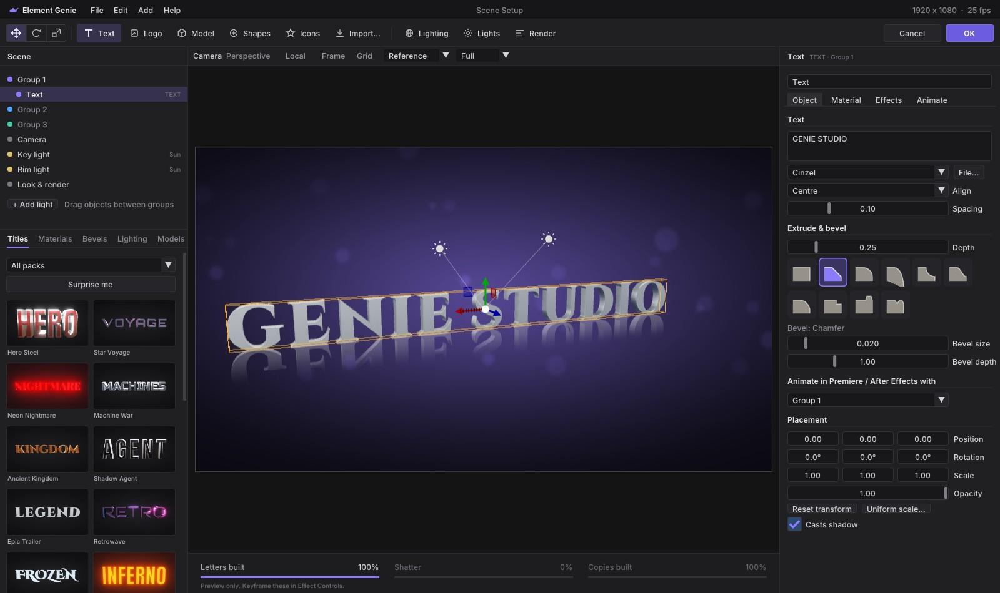
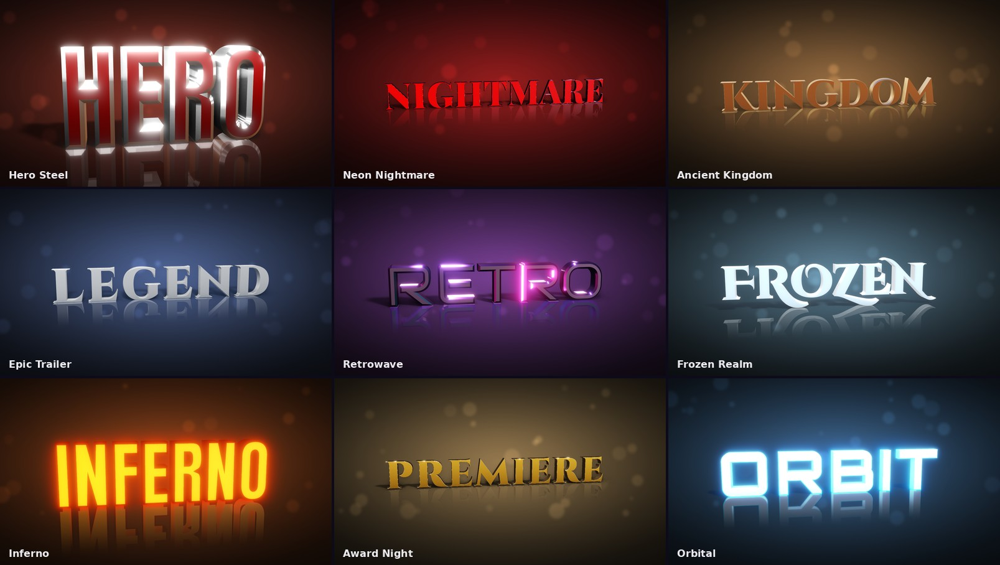
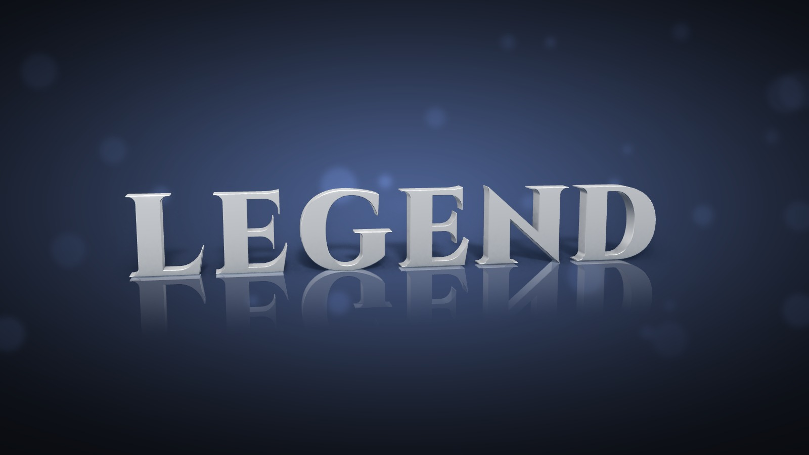
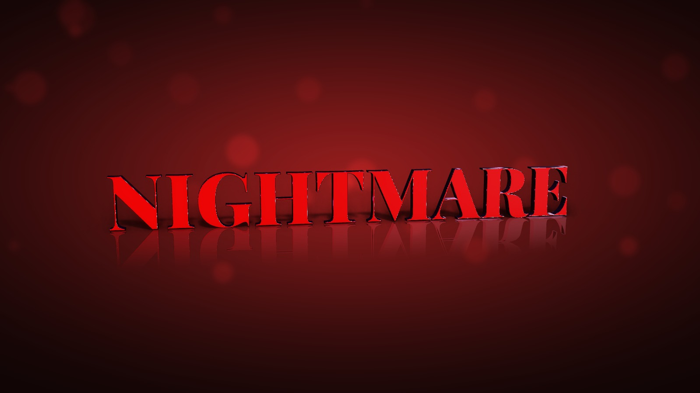

# Element Genie

Free, open-source cinematic 3D titles for **Premiere Pro and After Effects**. Made by [Genie Studio FX](https://geniestudiofx.github.io/genie-studio/).

**Version 1.0**

Drop the effect on an adjustment layer, click **Scene Setup…**, pick a movie-style look from the **Titles** tab, press OK, and your title animates in by itself. Fine-tune and keyframe everything in Effect Controls.

| | |
|---|---|
|  |  |

## Features

- **Titles tab:** 18 original 3D title looks (the *Cinematic* pack) inspired by movie-title genres, with one click for font, material, bevel, lighting, glow and fog
- **16 one-click animations** (Slam, Fly Through, Scatter, Tumble, Typewriter…) and **Auto Animate**: titles build in at the start of the clip, and optionally out at the end
- **Add-on packs:** looks are `.egpack` files; install more with *Install a pack…*
- **Animate in Effect Controls:** 5 groups, camera, letters built, per-letter rotate/move/scale, **twist, bend, taper, wobble**, extrusion depth, light rotate, self glow, shatter, replicator, depth of field and fog
- **After Effects 3D:** follows the comp camera (including depth of field) and reacts to light layers (point, spot, parallel, ambient, shadows); keyframes are added for you
- 3D text with 10 bevel styles, extruded SVG / PNG logos, 11 built-in cinematic fonts plus any installed font
- 28 materials and 7 lighting presets, or your own HDRI
- Import OBJ, FBX, glTF / GLB models; 18 built-in icons, 9 shapes and a sample model
- Soft shadows, ambient occlusion, floor reflections, glow, anti-aliasing and motion blur

## Download

Get the installer from the [website](https://geniestudiofx.github.io/genie-studio/element-genie.html).

- **Windows 10 / 11 (64-bit)**, graphics card with OpenGL 3.3
- **Premiere Pro and After Effects 2020 or newer.** The installer finds your versions; tick Premiere Pro and/or After Effects.

Windows may show a "Windows protected your PC" box because the installer isn't code-signed yet. Click **More info → Run anyway**.

## Build it yourself

Element Genie is cross-compiled for Windows with MinGW (tested on Linux).

1. Install mingw-w64 (posix threads), cmake, git and Python 3.
2. Download the Adobe After Effects SDK (free, from Adobe's developer site) and set `AE_SDK` to its `Examples` folder.
3. Fetch the libraries: `./get-deps.sh`
4. Compile the PiPL resource: `x86_64-w64-mingw32-windres plugin/ElementGeniePiPL.rc -O coff -o plugin/pipl.o`
5. Build: `./build.sh` → `build/ElementGenie.aex`, `build/Element Genie Scene Setup.exe` and `build/Element Genie Installer.exe`.

Title packs live in `presets/` (JSON). Cinematic fonts are in `ext/cinefonts` and are embedded by `tools/embed_fonts.py`. `test/host.cpp` is a small fake host for testing renders without Premiere.

## Licence

MIT — see [LICENSE](LICENSE). Free to use, change and share. Third-party licences are listed in [THIRD_PARTY_NOTICES.md](THIRD_PARTY_NOTICES.md).

Element Genie is an independent project and is not affiliated with Adobe or Video Copilot. Title looks are original designs inspired by film-title genres and are not affiliated with any film or studio.
